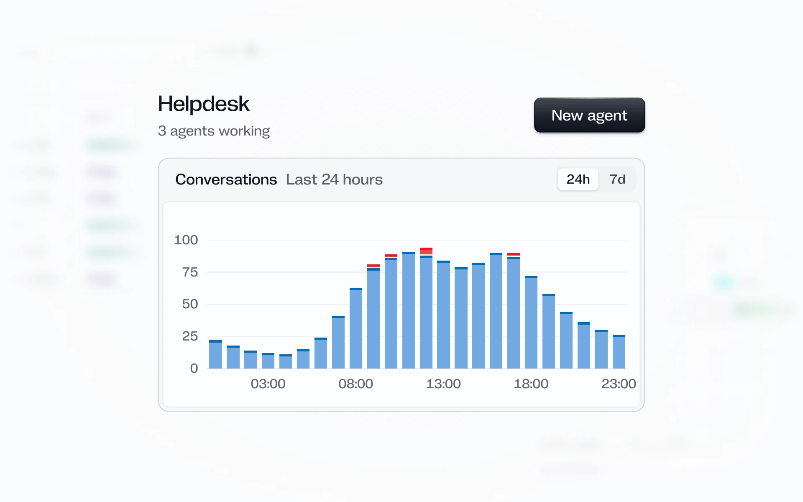

# design.how

Skills, design systems and visuals for coding agents, from [design.how](https://design.how).

## Install

```bash
npx skills@latest add https://design.how
```

It installs every skill below into Claude Code, Cursor, Codex or any agent that reads Agent Skills. `npx skills@latest add arla6ka/design.how` installs the same set from GitHub.

## Try it

Open your app's repo in your agent and say:

> Our UI is a mess, fix it.

design-system-boss reads the app, picks a playbook and runs the other skills in order. It ends with the system, one flow moved onto it and a CI check, then offers the full migration with its size. Every commit goes to a run branch, never your default branch.

## Requirements

- Node 18 or newer for the scripts.
- Playwright and a Chromium or Chrome for the screenshots build-design-system and migrate-design-system take. `find-chromium.mjs` finds one or says how to get it.
- For make-font, Python 3.9 or newer with `fonttools`, `brotli`, `uharfbuzz`, `numpy` and `pillow`, and Playwright for the font book PDF.

## Skills

<!-- skills:start -->
- [design-system-boss](skills/design-system-boss/SKILL.md). Runs the others.
- [build-design-system](skills/build-design-system/SKILL.md). Builds a system.
- [migrate-design-system](skills/migrate-design-system/SKILL.md). Migrates onto it.
- [token-mapping](skills/token-mapping/SKILL.md). Maps values to tokens.
- [component-docs](skills/component-docs/SKILL.md). Documents a component.
- [ui-review](skills/ui-review/SKILL.md). Reviews a screen.
- [make-font](skills/make-font/SKILL.md). Makes your own font.
- [make-motion](skills/make-motion/SKILL.md). Makes a motion graphics video.
<!-- skills:end -->

make-motion was called motion-video on its first day. If you installed it then, install again to get /make-motion.

The design system skills share one glossary, [glossary.md](skills/build-design-system/references/glossary.md), and one set of defaults for bans, widths and voice, [taste.md](skills/build-design-system/references/taste.md). Both ship inside build-design-system, so install it next to any skill you add alone: `npx skills@latest add arla6ka/design.how --skill build-design-system --skill ui-review`. Replace the taste file with your own. make-font stands on its own.

In Claude Code they also install as a plugin: `/plugin marketplace add arla6ka/design.how`, then `/plugin install design-system-skills@design-how`. `node evals/run.mjs --lint` checks the skills themselves, and `--triggers` asks a host which skill each prompt starts.

## Design systems



Each one installs with shadcn and brings its own skill, so your agent builds with its components and follows its rules. Open a folder for its components, its install line and the skill alone.

- [Glaze](systems/glaze). Glassy and compact, for AI products.
- [Lime](systems/lime). Warm and light, for consumer apps.
- [Quartz](systems/quartz). Cold and calm, for AI agents and developer tools.
- [Sodium](systems/sodium). Sharp and mono, for infrastructure and data tools.

## Vault

Visuals an agent can build into a page, each its own skill: `npx skills add https://design.how/vault/warp-type`. Every one, with its install line, is in [vault/README.md](vault/README.md).

## Links

- [design.how/skills](https://design.how/skills), the skills with a page for each
- [design.how/systems](https://design.how/systems), the docs for each system
- [design.how/vault](https://design.how/vault), every visual running

MIT licensed.
