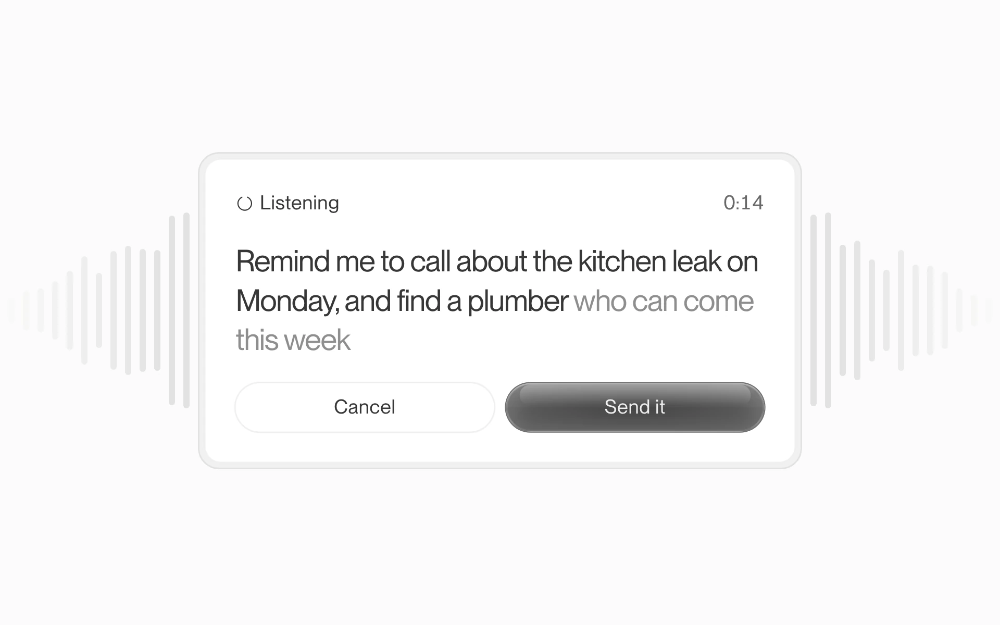
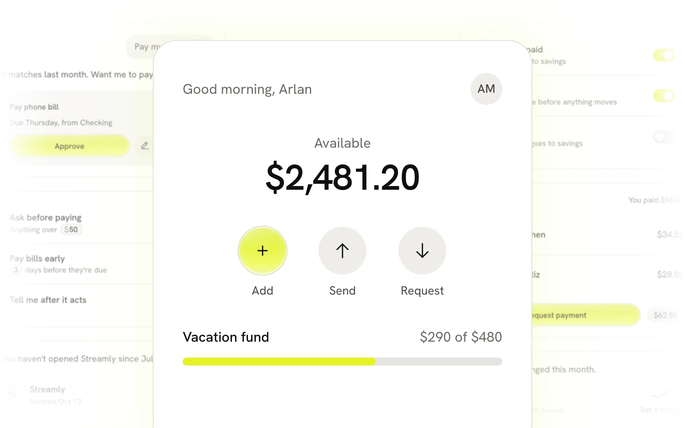
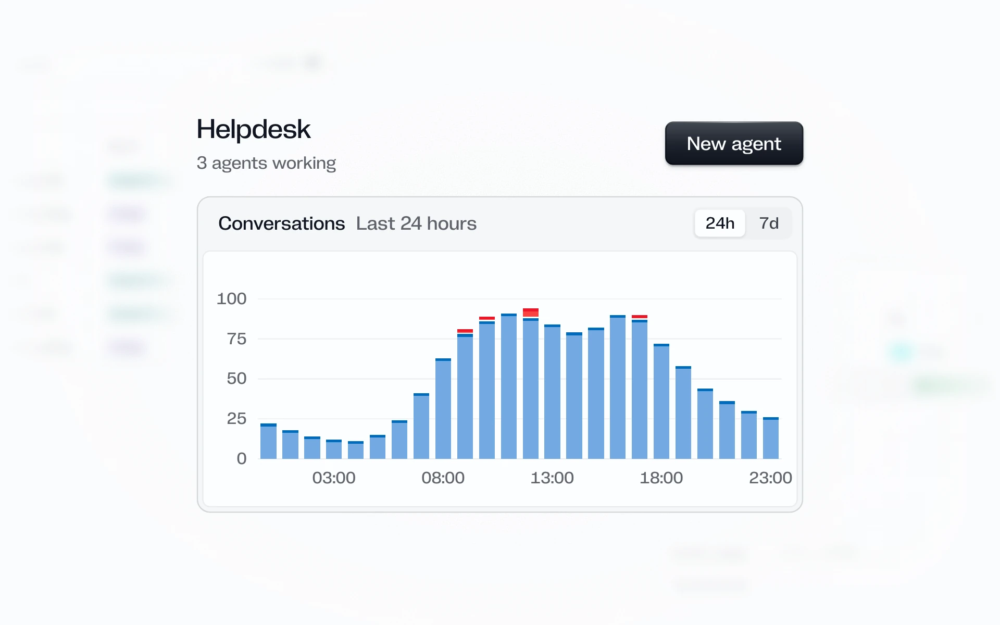
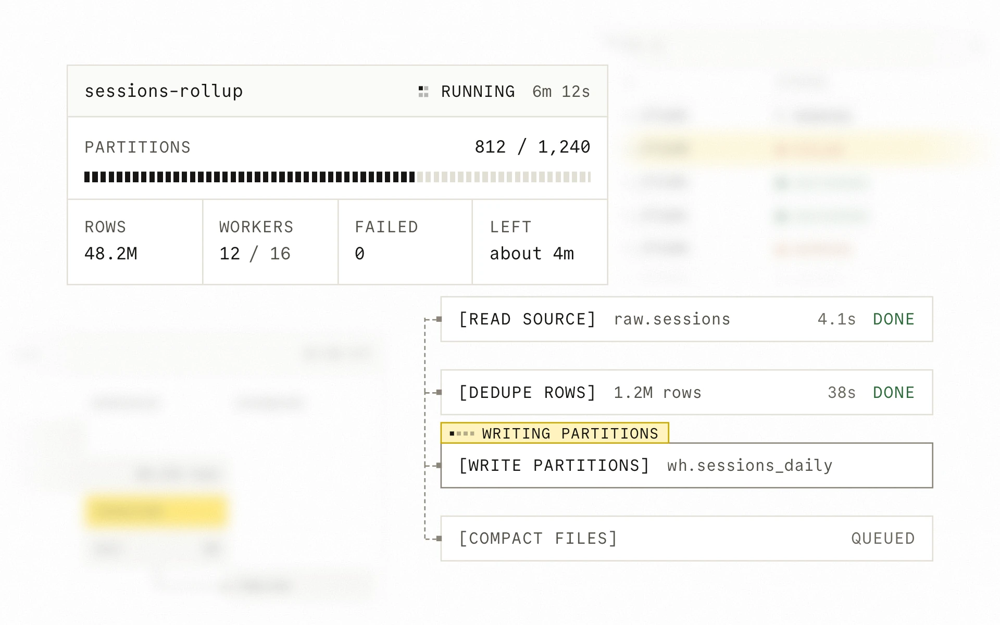

# design.how

Design systems, skills and visuals for coding agents, from [design.how](https://design.how).

## Install

```bash
npx skills@latest add https://design.how
```

Or from GitHub, which installs the same six skills:

```bash
npx skills@latest add arla6ka/design.how
```

One skill, with `build-design-system` beside it for the shared glossary, taste file and scripts: `npx skills@latest add arla6ka/design.how --skill build-design-system --skill ui-review`. A design system's skill without its code: `npx skills@latest add arla6ka/design.how/systems/quartz`.

It works with any coding agent that reads skills. In Claude Code you can also run `/plugin marketplace add arla6ka/design.how`, then `/plugin install design-system-skills@design-how`. To install by hand, copy the folders in `skills/` into your agent's skills folder, such as `.agents/skills/`.

## Design systems

Each one installs with shadcn and brings its own skill, so your agent builds with its components and follows its rules.

### Glaze



Glassy and compact, for AI products, with glass only on what you press.

```bash
npx shadcn@latest add https://design.how/r/glaze/theme.json
```

[Components and source](systems/glaze) and [docs](https://design.how/systems/glaze).

### Lime



Warm and light, for consumer apps, with one glowing action.

```bash
npx shadcn@latest add https://design.how/r/lime/theme.json
```

[Components and source](systems/lime) and [docs](https://design.how/systems/lime).

### Quartz



Cold and calm, for AI agents and developer tools, with colour only for what a thing is and what went wrong.

```bash
npx shadcn@latest add https://design.how/r/quartz/theme.json
```

[Components and source](systems/quartz) and [docs](https://design.how/systems/quartz).

### Sodium



Sharp and mono, for infrastructure and data tools, with one yellow action per view.

```bash
npx shadcn@latest add https://design.how/r/sodium/theme.json
```

[Components and source](systems/sodium) and [docs](https://design.how/systems/sodium).

## Skills

These turn the UI your app already ships into a design system your agent can use, add a check that catches new drift, and move every screen onto it when you ask.

- [design-system-boss](skills/design-system-boss/SKILL.md). Start here. Say what's wrong in plain words, and it reads the repo, picks a playbook and runs the other skills in order. It ends with the system, one flow moved onto it and a CI check, then offers the full migration with its size.
- [build-design-system](skills/build-design-system/SKILL.md). Builds tokens, one canonical component per family, docs and checks from the app you have, and proves them on one real flow.
- [migrate-design-system](skills/migrate-design-system/SKILL.md). Moves every screen onto the system with parallel workers, each checked against its before screenshot. Start with audit mode, which writes only its own notes under `.design-system/` and commits nothing.
- [token-mapping](skills/token-mapping/SKILL.md). Maps hex codes and pixel values to your tokens by purpose, so an 8px radius never stands in for an 8px gap. It never edits.
- [component-docs](skills/component-docs/SKILL.md). Writes a component's docs from its code and two real uses in your product, with the rules right next to the examples.
- [ui-review](skills/ui-review/SKILL.md). Reviews a screen or flow, including the states a screenshot misses, and ranks what's actually broken.

Shared words are in [glossary.md](skills/build-design-system/references/glossary.md), and the default bans, widths and voice in [taste.md](skills/build-design-system/references/taste.md). Both ship inside `build-design-system`, which the other skills build on, so install it next to any skill you add on its own. Replace the taste file with your own.

Ten scripts do what prose can't. `build-design-system` has `check-system.mjs`, `oklch.mjs`, `capture.mjs`, `capture-guard.mjs`, `pixdiff.mjs` and `find-chromium.mjs`. `migrate-design-system` has `land.mjs`, `legacy.mjs`, `bodies-check.mjs` and `parity.mjs`. Each has `--help` and `--self-test`, and the three that drive a browser need Playwright and a Chromium. `node evals/run.mjs --lint` checks the skills themselves, including that no word the glossary avoids creeps back, and `--triggers` asks a host which skill each prompt starts, or none. Each case in `evals/incidents/` only proves its rule is written down in the skill it names, not that an agent follows it. `--case <id>` prints one to run by hand.

## Vault

Visuals an agent can build into a page: moving type, shader fields and small interface pieces. Each one is its own skill, with a brief of what makes the effect, the FIXED steps, the VARIABLE values and a React and TypeScript template. Install one by name:

```bash
npx skills add https://design.how/vault/warp-type
```

Every visual pauses off screen and on a hidden tab, draws one still frame under reduced motion, caps the pixel ratio at 2 and cleans up when it unmounts. Each skill's `scripts/check.mjs` checks that your copy still does. Type falls back to system faces, and a visual built on photos or clips ships placeholders at the paths it reads, for you to replace with your own. The source and a README for each are in [vault/](vault).

<!-- vault:start -->
| Visual | What it does | Install |
|-|-|-|
| [Roll type](vault/roll-type) | Three short phrases taking turns, every word rolling up out of sight through glass as the next phrase rolls in under it. | `npx skills add https://design.how/vault/roll-type` |
| [Warp type](vault/warp-type) | Six short sentences, half a second each, where the verb bends its own letters. | `npx skills add https://design.how/vault/warp-type` |
| [Flip type](vault/flip-type) | One bold word that keeps becoming the next, each letter falling to a new row through a few random glyphs. | `npx skills add https://design.how/vault/flip-type` |
| [Cloud type](vault/cloud-type) | A line of white type that blows in as cloud, sharpens letter by letter, then lifts away as cloud again. | `npx skills add https://design.how/vault/cloud-type` |
| [Eclipse grid](vault/eclipse-grid) | Eighty rings sliding off the discs they hide, each on its own beat; the pointer is the lamp. | `npx skills add https://design.how/vault/eclipse-grid` |
| [Shutter type](vault/shutter-type) | Two lines of type through a rolling shutter: whatever moves tears into bands, whatever is still stays whole. | `npx skills add https://design.how/vault/shutter-type` |
| [Pop type](vault/pop-type) | Motion drops in letter by letter, squashes as it lands, swells like a balloon and pops. | `npx skills add https://design.how/vault/pop-type` |
| [Misprint type](vault/misprint-type) | HOLD ON, two prints that never register; press and hold to pull them together. | `npx skills add https://design.how/vault/misprint-type` |
| [Verb type](vault/verb-type) | Five words, each acting out its own verb in its own colours, cut hard. | `npx skills add https://design.how/vault/verb-type` |
| [Ripple grid](vault/ripple-grid) | A lattice of soft blobs that blooms into rings, twists and settles back to a grid. | `npx skills add https://design.how/vault/ripple-grid` |
| [Flood type](vault/flood-type) | A two-line word that falls in, floods the frame and tumbles out. | `npx skills add https://design.how/vault/flood-type` |
| [Phase table](vault/phase-table) | A four by six table of closed harmonic curves, lit as steel wire, breathing on one shared phase. | `npx skills add https://design.how/vault/phase-table` |
| [Swing type](vault/swing-type) | Huge letters swinging past a fixed window, turning edge-on so the word never assembles. | `npx skills add https://design.how/vault/swing-type` |
| [Spray burst](vault/spray-burst) | A screenprint that reprints itself every three seconds, every edge a boiling spray of dots. | `npx skills add https://design.how/vault/spray-burst` |
| [Rush type](vault/rush-type) | A word rests, then blasts toward you and tears into streaks of coloured light before the next one lands. | `npx skills add https://design.how/vault/rush-type` |
| [Ink flood](vault/ink-flood) | A pen writes a fat scribble, the scribble floods the frame, and its ink becomes the ground the next one is written on. | `npx skills add https://design.how/vault/ink-flood` |
| [Bond type](vault/bond-type) | Two words in a pixel face that unfold into a molecule, pixel bonds joining each letter to the next. | `npx skills add https://design.how/vault/bond-type` |
| [Dash cascade](vault/dash-cascade) | Three-letter words built from fat scanline dashes, unfurling out of a dotted line and folding back. | `npx skills add https://design.how/vault/dash-cascade` |
| [Wild type](vault/wild-type) | A design word types itself in, goes wild through one warp field, collapses home and un-types. | `npx skills add https://design.how/vault/wild-type` |
| [Loud burst](vault/loud-burst) | A sentence types itself in, one word heats up and bursts into coloured darts, and the line is thrown off the sides. | `npx skills add https://design.how/vault/loud-burst` |
| [Stamp type](vault/stamp-type) | Four lines on highlight bars hop in, park and scatter, each leaving blocks of flat colour behind. | `npx skills add https://design.how/vault/stamp-type` |
| [Reality split](vault/reality-split) | A selected word splits into letter objects, scatters, is inspected letter by letter at huge scale, and pops back whole. | `npx skills add https://design.how/vault/reality-split` |
| [Checker conveyor](vault/checker-conveyor) | Nine rows of checker cells whip sideways one after another, and each pulse carries in the next scene. | `npx skills add https://design.how/vault/checker-conveyor` |
| [Glass type](vault/glass-type) | Black serif type moving through one glass lens with a ripple in it, in three scenes that take turns. | `npx skills add https://design.how/vault/glass-type` |
| [Sunset slam](vault/sunset-slam) | A word squashes, slams forward into an extruded retro logo trailing a fan of dawn colour, cools to a sticker and unwinds. | `npx skills add https://design.how/vault/sunset-slam` |
| [Orbit](vault/orbit) | Twenty-six labelled cursors ride an invisible sphere around a thin breathing ring, and the sphere can be thrown. | `npx skills add https://design.how/vault/orbit` |
| [Word carousel](vault/word-carousel) | Four words on a three-slot conveyor that slams one slot left every half second, with a fourth hidden tiny behind the big one. | `npx skills add https://design.how/vault/word-carousel` |
| [Slide stack](vault/slide-stack) | Five dark blocks slide between two stops a beat out of step, and the orange behind them is traced from where they are. | `npx skills add https://design.how/vault/slide-stack` |
| [Spike type](vault/spike-type) | A word knocked out of a pale ground, its edge chewed ragged and bristling with hundreds of hand-drawn spikes. | `npx skills add https://design.how/vault/spike-type` |
| [Dot globe](vault/dot-globe) | Three rounded-cube solids tiled with rounded squares, rocking together, a bright symbol painted on them and handed along the row. | `npx skills add https://design.how/vault/dot-globe` |
| [Pixel threshold](vault/pixel-threshold) | A word printed into a flat colour poster in hard pixel blocks, collapsing and resolving into the next word. | `npx skills add https://design.how/vault/pixel-threshold` |
| [Code trail](vault/code-trail) | A staircase of code fragments on clashing coloured bars that trails the pointer. | `npx skills add https://design.how/vault/code-trail` |
| [Holo](vault/holo) | An identity card that tilts in 3D while a holographic foil slides over it and the picture flips its colours. | `npx skills add https://design.how/vault/holo` |
| [Glitch word](vault/glitch-word) | A word in a bright badge that tears into shoved bands in short bursts. | `npx skills add https://design.how/vault/glitch-word` |
| [Datamosh](vault/datamosh) | Columns of saturated colour that fall, snap open through the middle and squeeze shut, like a broken video decode. | `npx skills add https://design.how/vault/datamosh` |
| [AI lights](vault/ai-lights) | One body that becomes four agent UI components in turn, each announced by a pulse of light around its rim. | `npx skills add https://design.how/vault/ai-lights` |
| [Pixel brushes](vault/pixel-brushes) | A brush is one small shape stamped along a path, and five numbers turn it into a crisp line or a loose spray. | `npx skills add https://design.how/vault/pixel-brushes` |
| [Voice wave](vault/voice-wave) | A ribbon of light that moves like a voice and splits into colour where it bends, and can listen to yours. | `npx skills add https://design.how/vault/voice-wave` |
| [Fade motion](vault/fade-motion) | A pixel word trailing into light, its fade built from two hundred overlapping copies. | `npx skills add https://design.how/vault/fade-motion` |
| [Dot cut](vault/dot-cut) | A dense grid of touching circles with a letter or a pattern cut out of it as negative space. | `npx skills add https://design.how/vault/dot-cut` |
| [Liquid UI](vault/liquid-ui) | Cards that fuse where they meet, the corner between them curving inward like poured liquid. | `npx skills add https://design.how/vault/liquid-ui` |
| [Kinetic typography](vault/kinetic-typography) | One heavy letter cut into a grid of tiles, each slipping on its own wave, so the letter ripples like cloth. | `npx skills add https://design.how/vault/kinetic-typography` |
| [Liquid metal](vault/liquid-metal) | One word as flowing polished metal on black, its reflection streaming as the pointer moves. | `npx skills add https://design.how/vault/liquid-metal` |
| [Folder embroidery](vault/folder-embroidery) | Three embroidered word patches stitched onto cloth, with a glint on hover and a press that springs back. | `npx skills add https://design.how/vault/folder-embroidery` |
| [Smooth corners](vault/squircle) | A glossy button whose corners are a superellipse that flows into the edge with no kink. | `npx skills add https://design.how/vault/squircle` |
| [Badge trail](vault/badge-trail) | Tiny coloured badges of design terms that slam in behind the pointer and flick away. | `npx skills add https://design.how/vault/badge-trail` |
| [Blur glow](vault/blur-glow) | A crisp rounded word in a soft gradient-mapped glow on light paper, dissolving into the next word and colour. | `npx skills add https://design.how/vault/blur-glow` |
| [Text reveal](vault/text-reveal) | Two small serif text blocks that un-blur into focus through a cloudy mask, corner by corner, then clear and return. | `npx skills add https://design.how/vault/text-reveal` |
| [Ransom note](vault/ransom-note) | Short phrases spelled in mismatched paper scraps that rise in one by one, hold and lift away. | `npx skills add https://design.how/vault/ransom-note` |
| [Brick reveal](vault/brick-reveal) | A picture restyled as toy bricks, voxels and a cartoon that peels back to the plain picture behind the pointer. | `npx skills add https://design.how/vault/brick-reveal` |
| [Chromatic glow](vault/chroma-glow) | A word that glows on a coloured wall and splits into warm and cool copies at its edges. | `npx skills add https://design.how/vault/chroma-glow` |
| [Realistic emboss](vault/emboss) | Words and shapes pressed hard into tinted plaster, with the light catching every edge. | `npx skills add https://design.how/vault/emboss` |
| [Blur reveal](vault/blur-reveal) | Coloured panels in turn, each short line dissolving in out of a blur and drifting into focus. | `npx skills add https://design.how/vault/blur-reveal` |
| [Word stickers](vault/word-stickers) | Die-cut word stickers that pop in one by one, peel up when grabbed and fling with momentum. | `npx skills add https://design.how/vault/word-stickers` |
| [Design tiles](vault/design-tiles) | A short sentence as words on bold colour fields, packed into one bar, each field stepped to its letters. | `npx skills add https://design.how/vault/design-tiles` |
| [Image sphere](vault/image-sphere) | A cloud of photos on an invisible sphere that drifts, spins on a drag and opens one on a click. | `npx skills add https://design.how/vault/image-sphere` |
| [Crystal cluster](vault/crystal-cluster) | A gold-outlined crystal cluster floating in a flickering gold beam of light. | `npx skills add https://design.how/vault/crystal-cluster` |
| [Cursors](vault/cursors) | Three labelled collaborator cursors orbit a frosted-glass word and scatter from your pointer. | `npx skills add https://design.how/vault/cursors` |
| [Typer](vault/typer) | A line that types itself in, each letter flickering through pills and highlights before it lands. | `npx skills add https://design.how/vault/typer` |
| [Image galaxy](vault/image-galaxy) | Small photographs drifting through a perspective field, growing as they fall and wrapping forever. | `npx skills add https://design.how/vault/image-galaxy` |
| [Colour depth](vault/color-depth) | Buttons that look like real objects, glossy or lit from inside, from gradients and inset shadows alone. | `npx skills add https://design.how/vault/color-depth` |
| [Pixel cycle](vault/pixel-cycle) | One character at a time, breaking into big blocks and resolving sharp, then swapped for the next. | `npx skills add https://design.how/vault/pixel-cycle` |
| [Ghosty reveal](vault/ghosty-reveal) | Photographs that bleed in and out of view through a soft, cloudy mask, like forming out of fog. | `npx skills add https://design.how/vault/ghosty-reveal` |
| [Symbols effect](vault/sandbox) | A live halftone that rebuilds a clip from small tinted symbols, one per brightness band. | `npx skills add https://design.how/vault/sandbox` |
| [Pixel scan](vault/pixel-scan) | A diagonal band assembles a word out of a spray of tiny blocks, then a pool of blocks follows the pointer. | `npx skills add https://design.how/vault/pixel-scan` |
| [Peak gradient](vault/peak-gradient) | A soft rainbow glow of blurred columns that rises from the floor, tallest in the middle. | `npx skills add https://design.how/vault/peak-gradient` |
| [Pixel fire](vault/pixel-fire) | A 16 by 16 pixel-art fire on a block, where the pointer moves the real pixels and a tap blows it out. | `npx skills add https://design.how/vault/pixel-fire` |
| [Vector editor](vault/vector-editor) | A design tool's selected-layer look for the web: a blue frame, corner handles, a size badge and a live bezier rig. | `npx skills add https://design.how/vault/vector-editor` |
| [Tile field](vault/tile-field) | A word made of tiny tiles, lit by a slow colour wave and a soft pointer light that leaves a wake. | `npx skills add https://design.how/vault/tile-field` |
| [Hover video button](vault/hover-video) | Pill buttons that swap themselves for a short clip of their label puffing up into glossy letters. | `npx skills add https://design.how/vault/hover-video` |
<!-- vault:end -->

## Why

Agents copy whatever is in the repo. If it has three buttons, forty grays and a token file half the code ignores, every new screen picks a different one. So each piece here hands the agent something it can check instead of a guess. A design system is a finished set of components and rules to build with. The skills screenshot every route before the first edit, map values to tokens by what they do and add checks that fail when a screen drifts, and every commit goes to a run branch, never your default branch. A visual is the one idea behind an effect with the numbers that make it work, and a check that it keeps the page fast.

MIT licensed.
