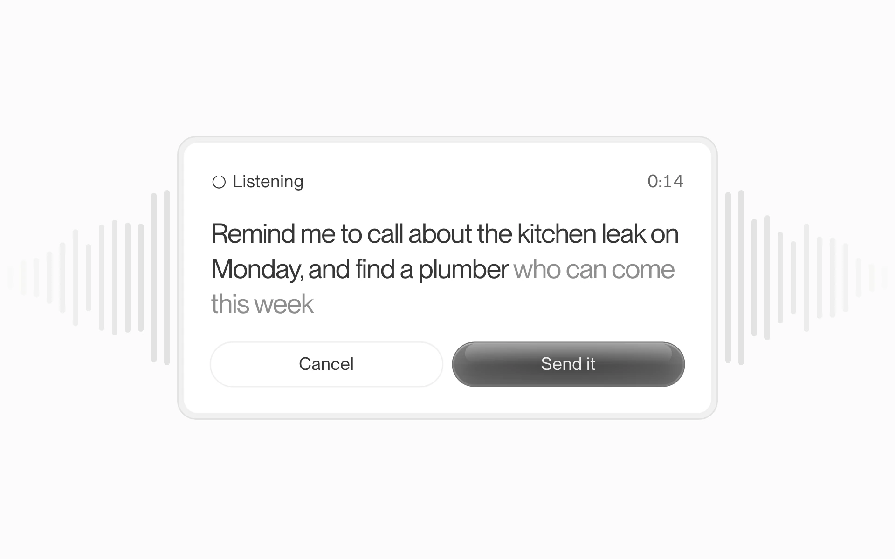

# Glaze

Compact black and white for AI products, with glass only on the one action you press next.



## Install

```bash
npx shadcn@latest add https://design.how/r/glaze/theme.json
```

The theme brings the tokens, the styles and the Glaze skill, which your coding agent follows whenever it builds UI. Add components by name, such as `https://design.how/r/glaze/button.json`.

The skill alone, without the code: `npx skills@latest add arla6ka/design.how/systems/glaze`.

## Components

- Actions: [Button](https://design.how/systems/glaze/components/button), [Toolbar](https://design.how/systems/glaze/components/toolbar), [Copy button](https://design.how/systems/glaze/components/copy-button), [Button group](https://design.how/systems/glaze/components/button-group)
- Inputs: [Field](https://design.how/systems/glaze/components/field), [Input](https://design.how/systems/glaze/components/input), [Textarea](https://design.how/systems/glaze/components/textarea), [Chip](https://design.how/systems/glaze/components/chip), [Date picker](https://design.how/systems/glaze/components/date-picker), [Number input](https://design.how/systems/glaze/components/number-input), [OTP input](https://design.how/systems/glaze/components/otp-input)
- Selection: [Checkbox](https://design.how/systems/glaze/components/checkbox), [Radio group](https://design.how/systems/glaze/components/radio-group), [Switch](https://design.how/systems/glaze/components/switch), [Slider](https://design.how/systems/glaze/components/slider), [Segmented control](https://design.how/systems/glaze/components/segmented-control), [Select](https://design.how/systems/glaze/components/select), [Combobox](https://design.how/systems/glaze/components/combobox)
- Display: [Kbd](https://design.how/systems/glaze/components/kbd), [Card](https://design.how/systems/glaze/components/card), [Panel](https://design.how/systems/glaze/components/panel), [Badge](https://design.how/systems/glaze/components/badge), [Avatar](https://design.how/systems/glaze/components/avatar), [Item](https://design.how/systems/glaze/components/item), [Data list](https://design.how/systems/glaze/components/data-list), [Truncate](https://design.how/systems/glaze/components/truncate), [Relative time](https://design.how/systems/glaze/components/relative-time)
- Feedback: [Status](https://design.how/systems/glaze/components/status), [Skeleton](https://design.how/systems/glaze/components/skeleton), [Progress](https://design.how/systems/glaze/components/progress), [Empty state](https://design.how/systems/glaze/components/empty-state), [Alert](https://design.how/systems/glaze/components/alert), [Toast](https://design.how/systems/glaze/components/toast)
- Overlays: [Dialog](https://design.how/systems/glaze/components/dialog), [Sheet](https://design.how/systems/glaze/components/sheet), [Popover](https://design.how/systems/glaze/components/popover), [Tooltip](https://design.how/systems/glaze/components/tooltip), [Dropdown menu](https://design.how/systems/glaze/components/dropdown-menu), [Command](https://design.how/systems/glaze/components/command)
- Navigation: [Tabs](https://design.how/systems/glaze/components/tabs), [Breadcrumb](https://design.how/systems/glaze/components/breadcrumb), [Steps](https://design.how/systems/glaze/components/steps), [Pagination](https://design.how/systems/glaze/components/pagination)
- Layout: [Collapsible](https://design.how/systems/glaze/components/collapsible)
- Data: [Filter bar](https://design.how/systems/glaze/components/filter-bar), [Table](https://design.how/systems/glaze/components/table), [Data grid](https://design.how/systems/glaze/components/data-grid), [Bulk action bar](https://design.how/systems/glaze/components/bulk-action-bar), [Timeline](https://design.how/systems/glaze/components/timeline)
- Code: [Code block](https://design.how/systems/glaze/components/code-block), [JSON view](https://design.how/systems/glaze/components/json-view), [Log viewer](https://design.how/systems/glaze/components/log-viewer)
- Media and charts: [Attachment](https://design.how/systems/glaze/components/attachment), [Chart](https://design.how/systems/glaze/components/chart)
- AI: [Prompt input](https://design.how/systems/glaze/components/prompt-input), [Send button](https://design.how/systems/glaze/components/send-button), [Mention](https://design.how/systems/glaze/components/mention), [Message](https://design.how/systems/glaze/components/message), [Conversation](https://design.how/systems/glaze/components/conversation), [Response](https://design.how/systems/glaze/components/response), [Reasoning](https://design.how/systems/glaze/components/reasoning), [Tool call](https://design.how/systems/glaze/components/tool-call), [Activity](https://design.how/systems/glaze/components/activity), [Follow-ups](https://design.how/systems/glaze/components/follow-ups), [Action receipt](https://design.how/systems/glaze/components/action-receipt), [Autonomy rule](https://design.how/systems/glaze/components/autonomy-rule)

## Blocks

Whole screens built only from the components above.

- Today: `npx shadcn@latest add https://design.how/r/glaze/today.json`
- Voice capture: `npx shadcn@latest add https://design.how/r/glaze/voice-capture.json`
- Note recap: `npx shadcn@latest add https://design.how/r/glaze/note-recap.json`
- Booking approval: `npx shadcn@latest add https://design.how/r/glaze/booking-approval.json`
- Assistant limits: `npx shadcn@latest add https://design.how/r/glaze/assistant-limits.json`
- Conversation insights: `npx shadcn@latest add https://design.how/r/glaze/conversation-insights.json`
- Cited answer: `npx shadcn@latest add https://design.how/r/glaze/cited-answer.json`
- Agent plan: `npx shadcn@latest add https://design.how/r/glaze/agent-plan.json`
- Agent procedure: `npx shadcn@latest add https://design.how/r/glaze/agent-procedure.json`
- Simulations: `npx shadcn@latest add https://design.how/r/glaze/simulations.json`
- Experiment: `npx shadcn@latest add https://design.how/r/glaze/experiment.json`

Docs at [design.how/systems/glaze](https://design.how/systems/glaze).
