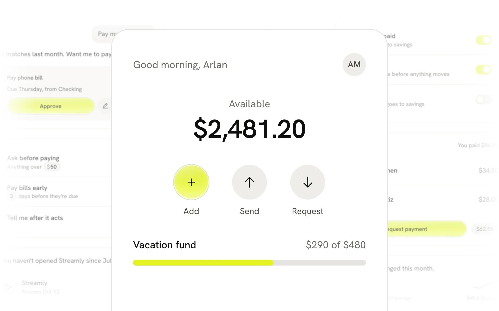

# Lime

A warm, light system for consumer apps, with one glowing action.



## Install

```bash
npx shadcn@latest add https://design.how/r/lime/theme.json
```

The theme brings the tokens, the styles and the Lime skill, which your coding agent follows whenever it builds UI. Add components by name, such as `https://design.how/r/lime/button.json`.

The skill alone, without the code: `npx skills@latest add arla6ka/design.how/systems/lime`.

## Components

- Actions: [Button](https://design.how/systems/lime/components/button), [Copy button](https://design.how/systems/lime/components/copy-button)
- Inputs: [Input](https://design.how/systems/lime/components/input), [Textarea](https://design.how/systems/lime/components/textarea), [Field](https://design.how/systems/lime/components/field), [Select](https://design.how/systems/lime/components/select), [Combobox](https://design.how/systems/lime/components/combobox), [Dropzone](https://design.how/systems/lime/components/dropzone), [Keypad](https://design.how/systems/lime/components/keypad)
- Selection: [Checkbox](https://design.how/systems/lime/components/checkbox), [Radio](https://design.how/systems/lime/components/radio), [Switch](https://design.how/systems/lime/components/switch), [Slider](https://design.how/systems/lime/components/slider), [Segmented](https://design.how/systems/lime/components/segmented), [Chip](https://design.how/systems/lime/components/chip)
- Display: [Badge](https://design.how/systems/lime/components/badge), [Avatar](https://design.how/systems/lime/components/avatar), [Card](https://design.how/systems/lime/components/card), [Table](https://design.how/systems/lime/components/table), [List](https://design.how/systems/lime/components/list), [Progress](https://design.how/systems/lime/components/progress), [Amount](https://design.how/systems/lime/components/amount), [Bill schedule](https://design.how/systems/lime/components/bill-schedule), [Balance](https://design.how/systems/lime/components/balance)
- Feedback: [Status](https://design.how/systems/lime/components/status), [Empty](https://design.how/systems/lime/components/empty), [Skeleton](https://design.how/systems/lime/components/skeleton), [Error state](https://design.how/systems/lime/components/error-state), [Toast](https://design.how/systems/lime/components/toast), [Payment done](https://design.how/systems/lime/components/payment-done)
- Overlays: [Dialog](https://design.how/systems/lime/components/dialog), [Alert dialog](https://design.how/systems/lime/components/alert-dialog), [Sheet](https://design.how/systems/lime/components/sheet), [Popover](https://design.how/systems/lime/components/popover), [Dropdown menu](https://design.how/systems/lime/components/dropdown-menu), [Tooltip](https://design.how/systems/lime/components/tooltip)
- Navigation: [Tabs](https://design.how/systems/lime/components/tabs), [Toolbar](https://design.how/systems/lime/components/toolbar)
- Layout: [Accordion](https://design.how/systems/lime/components/accordion), [Separator](https://design.how/systems/lime/components/separator), [Scroll area](https://design.how/systems/lime/components/scroll-area)
- Assistant: [Chat input](https://design.how/systems/lime/components/chat-input), [Message](https://design.how/systems/lime/components/message), [Tool call](https://design.how/systems/lime/components/tool-call), [Follow ups](https://design.how/systems/lime/components/follow-ups), [Approval request](https://design.how/systems/lime/components/approval-request), [Action receipt](https://design.how/systems/lime/components/action-receipt), [Autonomy rule](https://design.how/systems/lime/components/autonomy-rule), [Receipt match](https://design.how/systems/lime/components/receipt-match), [Insight](https://design.how/systems/lime/components/insight)

## Blocks

Whole screens built only from the components above.

- Home screen: `npx shadcn@latest add https://design.how/r/lime/home.json`
- Assistant approval: `npx shadcn@latest add https://design.how/r/lime/assistant-approval.json`
- Assistant alert: `npx shadcn@latest add https://design.how/r/lime/assistant-alert.json`
- Settings rules: `npx shadcn@latest add https://design.how/r/lime/settings-rules.json`
- Split request: `npx shadcn@latest add https://design.how/r/lime/split-request.json`

Docs at [design.how/systems/lime](https://design.how/systems/lime).
