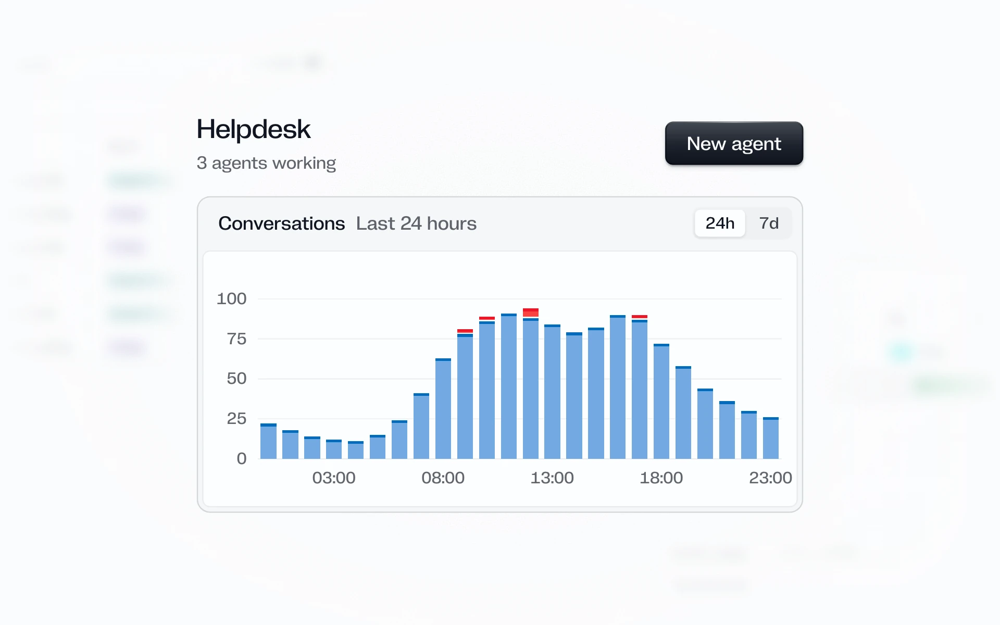

# Quartz

For AI agents and developer tools: runs, approvals, keys and releases.



## Install

```bash
npx shadcn@latest add https://design.how/r/quartz/theme.json
```

The theme brings the tokens, the styles and the Quartz skill, which your coding agent follows whenever it builds UI. Add components by name, such as `https://design.how/r/quartz/button.json`.

The skill alone, without the code: `npx skills@latest add arla6ka/design.how/systems/quartz`.

## Components

- Actions: [Button](https://design.how/systems/quartz/components/button), [Button group](https://design.how/systems/quartz/components/button-group), [Copy button](https://design.how/systems/quartz/components/copy-button)
- Inputs: [Input](https://design.how/systems/quartz/components/input), [Textarea](https://design.how/systems/quartz/components/textarea), [Field](https://design.how/systems/quartz/components/field), [Date picker](https://design.how/systems/quartz/components/date-picker), [Combobox](https://design.how/systems/quartz/components/combobox)
- Selection: [Checkbox](https://design.how/systems/quartz/components/checkbox), [Radio group](https://design.how/systems/quartz/components/radio-group), [Switch](https://design.how/systems/quartz/components/switch), [Slider](https://design.how/systems/quartz/components/slider), [Select](https://design.how/systems/quartz/components/select), [Segmented control](https://design.how/systems/quartz/components/segmented-control)
- Display: [Badge](https://design.how/systems/quartz/components/badge), [Chip](https://design.how/systems/quartz/components/chip), [Status](https://design.how/systems/quartz/components/status), [Stat](https://design.how/systems/quartz/components/stat), [Avatar](https://design.how/systems/quartz/components/avatar), [Kbd](https://design.how/systems/quartz/components/kbd), [Relative time](https://design.how/systems/quartz/components/relative-time), [Truncate](https://design.how/systems/quartz/components/truncate), [Item](https://design.how/systems/quartz/components/item), [Card](https://design.how/systems/quartz/components/card), [Panel](https://design.how/systems/quartz/components/panel), [Data list](https://design.how/systems/quartz/components/data-list)
- Feedback: [Alert](https://design.how/systems/quartz/components/alert), [Toast](https://design.how/systems/quartz/components/toast), [Empty state](https://design.how/systems/quartz/components/empty-state), [Skeleton](https://design.how/systems/quartz/components/skeleton), [Progress](https://design.how/systems/quartz/components/progress)
- Overlays: [Dialog](https://design.how/systems/quartz/components/dialog), [Sheet](https://design.how/systems/quartz/components/sheet), [Popover](https://design.how/systems/quartz/components/popover), [Tooltip](https://design.how/systems/quartz/components/tooltip), [Dropdown menu](https://design.how/systems/quartz/components/dropdown-menu), [Command](https://design.how/systems/quartz/components/command)
- Navigation: [Tabs](https://design.how/systems/quartz/components/tabs), [Breadcrumb](https://design.how/systems/quartz/components/breadcrumb), [Pagination](https://design.how/systems/quartz/components/pagination)
- Layout: [Collapsible](https://design.how/systems/quartz/components/collapsible)
- Data: [Table](https://design.how/systems/quartz/components/table), [Filter bar](https://design.how/systems/quartz/components/filter-bar), [Timeline](https://design.how/systems/quartz/components/timeline), [Data grid](https://design.how/systems/quartz/components/data-grid)
- Code: [Code block](https://design.how/systems/quartz/components/code-block), [JSON view](https://design.how/systems/quartz/components/json-view), [Log viewer](https://design.how/systems/quartz/components/log-viewer)
- Media and charts: [Attachment](https://design.how/systems/quartz/components/attachment), [Chart](https://design.how/systems/quartz/components/chart)
- AI: [Message](https://design.how/systems/quartz/components/message), [Conversation](https://design.how/systems/quartz/components/conversation), [Response](https://design.how/systems/quartz/components/response), [Reasoning](https://design.how/systems/quartz/components/reasoning), [Tool call](https://design.how/systems/quartz/components/tool-call), [Activity](https://design.how/systems/quartz/components/activity), [Prompt input](https://design.how/systems/quartz/components/prompt-input)

## Blocks

Whole screens built only from the components above.

- Workspace home: `npx shadcn@latest add https://design.how/r/quartz/project-home.json`
- Agent session: `npx shadcn@latest add https://design.how/r/quartz/agent-session.json`
- Tool approval: `npx shadcn@latest add https://design.how/r/quartz/tool-approval.json`
- API keys: `npx shadcn@latest add https://design.how/r/quartz/api-keys.json`
- Prompt release: `npx shadcn@latest add https://design.how/r/quartz/deploy-detail.json`
- Run trace: `npx shadcn@latest add https://design.how/r/quartz/run-trace.json`
- Live activity: `npx shadcn@latest add https://design.how/r/quartz/live-requests.json`

Docs at [design.how/systems/quartz](https://design.how/systems/quartz).
