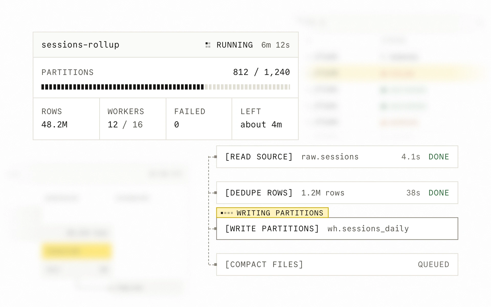

# Sodium

Sharp and mono, for infrastructure and data tools.



## Install

```bash
npx shadcn@latest add https://design.how/r/sodium/theme.json
```

The theme brings the tokens, the styles and the Sodium skill, which your coding agent follows whenever it builds UI. Add components by name, such as `https://design.how/r/sodium/button.json`.

The skill alone, without the code: `npx skills@latest add arla6ka/design.how/systems/sodium`.

## Components

- Actions: [Button](https://design.how/systems/sodium/components/button), [Button group](https://design.how/systems/sodium/components/button-group), [Copy button](https://design.how/systems/sodium/components/copy-button)
- Inputs: [Field](https://design.how/systems/sodium/components/field), [Input](https://design.how/systems/sodium/components/input), [Textarea](https://design.how/systems/sodium/components/textarea), [Select](https://design.how/systems/sodium/components/select), [Combobox](https://design.how/systems/sodium/components/combobox)
- Selection: [Checkbox](https://design.how/systems/sodium/components/checkbox), [Radio group](https://design.how/systems/sodium/components/radio-group), [Switch](https://design.how/systems/sodium/components/switch), [Slider](https://design.how/systems/sodium/components/slider), [Segmented control](https://design.how/systems/sodium/components/segmented-control)
- Display: [Tag](https://design.how/systems/sodium/components/tag), [Status strip](https://design.how/systems/sodium/components/status-strip), [Avatar](https://design.how/systems/sodium/components/avatar), [Kbd](https://design.how/systems/sodium/components/kbd), [Item](https://design.how/systems/sodium/components/item), [Data list](https://design.how/systems/sodium/components/data-list)
- Feedback: [Status](https://design.how/systems/sodium/components/status), [Meter](https://design.how/systems/sodium/components/meter), [Progress](https://design.how/systems/sodium/components/progress), [Alert](https://design.how/systems/sodium/components/alert), [Toast](https://design.how/systems/sodium/components/toast), [Empty state](https://design.how/systems/sodium/components/empty-state), [Skeleton](https://design.how/systems/sodium/components/skeleton)
- Overlays: [Dialog](https://design.how/systems/sodium/components/dialog), [Sheet](https://design.how/systems/sodium/components/sheet), [Popover](https://design.how/systems/sodium/components/popover), [Tooltip](https://design.how/systems/sodium/components/tooltip), [Dropdown menu](https://design.how/systems/sodium/components/dropdown-menu), [Command](https://design.how/systems/sodium/components/command)
- Navigation: [Tabs](https://design.how/systems/sodium/components/tabs), [Numbered tabs](https://design.how/systems/sodium/components/numbered-tabs), [Breadcrumb](https://design.how/systems/sodium/components/breadcrumb), [Pagination](https://design.how/systems/sodium/components/pagination)
- Layout: [Collapsible](https://design.how/systems/sodium/components/collapsible), [Frame](https://design.how/systems/sodium/components/frame)
- Data: [Table](https://design.how/systems/sodium/components/table), [Filter bar](https://design.how/systems/sodium/components/filter-bar)
- Code: [Code block](https://design.how/systems/sodium/components/code-block), [Code window](https://design.how/systems/sodium/components/code-window), [JSON view](https://design.how/systems/sodium/components/json-view), [Log viewer](https://design.how/systems/sodium/components/log-viewer)
- Charts: [Chart](https://design.how/systems/sodium/components/chart), [Stem chart](https://design.how/systems/sodium/components/stem-chart), [Swimlanes](https://design.how/systems/sodium/components/swimlanes), [Bar blocks](https://design.how/systems/sodium/components/bar-blocks)
- Runs and agents: [Tool-call row](https://design.how/systems/sodium/components/tool-call-row), [Tool call](https://design.how/systems/sodium/components/tool-call), [Activity](https://design.how/systems/sodium/components/activity), [Prompt input](https://design.how/systems/sodium/components/prompt-input), [Message](https://design.how/systems/sodium/components/message), [Response](https://design.how/systems/sodium/components/response)

## Blocks

Whole screens built only from the components above.

- Job runs: `npx shadcn@latest add https://design.how/r/sodium/job-runs.json`
- Failed load: `npx shadcn@latest add https://design.how/r/sodium/failed-load.json`
- On call: `npx shadcn@latest add https://design.how/r/sodium/on-call.json`
- Run progress: `npx shadcn@latest add https://design.how/r/sodium/run-progress.json`
- Warehouse capacity: `npx shadcn@latest add https://design.how/r/sodium/warehouse-capacity.json`
- Sync flow: `npx shadcn@latest add https://design.how/r/sodium/sync-flow.json`
- Pipeline history: `npx shadcn@latest add https://design.how/r/sodium/pipeline-history.json`

Docs at [design.how/systems/sodium](https://design.how/systems/sodium).
